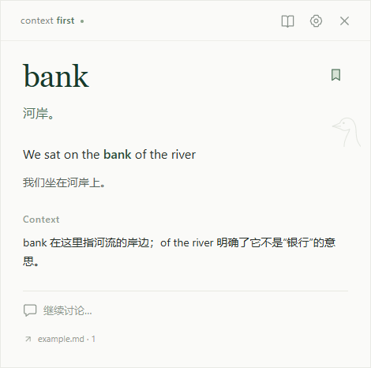

# Context-First English

一个面向个人使用的 Windows / Linux 桌面英语工具：在浏览器或 VS Code 中选中表达，主动打开浮窗，查看语境词义、原句翻译、简短解释，继续追问并收藏。界面使用暖白背景与小鹅线稿，视频和毛玻璃效果暂不做。

当前实现使用 Electron、React 和 TypeScript。两个采集扩展通过已配对、带鉴权的本机 HTTP 连接发送文本；桌面端使用 `CodexProvider` 调用本机 Codex，收藏按 v0.1 schema 保存为本地 JSON。



## 本地运行

需要 Node.js 22 或更新版本、npm，以及 Windows 或有图形桌面的 Linux 环境。在仓库根目录执行：

```sh
npm ci
npm start
```

`npm start` 会先构建桌面应用和两个扩展，再启动浮窗。第一次安装依赖需要下载 Electron。点击浮窗的关闭按钮或按 Esc 会隐藏窗口；从系统托盘可以重新打开或退出应用。

AI 需要本机 Codex 0.164.0 或更新版本，并已完成登录。应用默认自动查找已安装的兼容 Codex，复用已有登录与默认模型，无需填写路径或模型。只有需要覆盖默认行为时，才展开设置中的“高级设置”；可随时点击“恢复自动连接”。版本要求、发现顺序、登录与能力限制见 [Codex 接入说明](docs/codex-integration.md)。

## 连接浏览器与 VS Code

先保持桌面应用运行，打开设置，取得本机配对码和端口，默认端口为 `37719`。

- **Chrome / Edge：**在扩展管理页开启开发者模式，加载已构建的 `extensions/browser` 目录，在扩展设置中填写配对码和端口。
- **VS Code：**安装 `release/context-first-vscode-0.1.0.vsix`，运行命令 `Context First: 连接桌面应用`，填写相同信息。自行生成 VSIX 可执行 `npm run build`，再执行 `node extensions/vscode/package.mjs`。

在普通网页正文或 VS Code 编辑器中选择文字，按 `Alt+Shift+D`，也可用右键菜单；浏览器还支持工具栏按钮。完整安装、权限、快捷键及排错说明见 [文本采集扩展](docs/extensions.md)。

扩展仅在主动触发时读取选区和有限的邻近原文，不监听全局剪贴板。桌面桥仅监听 `127.0.0.1`，请求需要配对码，并校验来源和数据。所选表达及邻近原文会交给 Codex 生成解释。

## 构建与文件夹产物

```sh
npm run build
npm run package
```

`build` 生成 `dist` 和扩展运行文件；`package` 使用当前系统安装的 Electron，生成该系统的应用文件夹。Windows 与 Linux 分别在对应环境构建，当前产物位置为：

| 产物 | 使用方式 |
|---|---|
| `release/win-unpacked/` | 保留整个文件夹，运行 `Context First.exe` |
| `release/linux-unpacked/` | 保留整个文件夹和可执行权限，在 Linux 图形桌面中运行 `context-first-english` |
| `release/context-first-vscode-0.1.0.vsix` | VS Code 的“从 VSIX 安装” |
| `release/context-first-browser-0.1.0.zip` | 解压后在 Chrome / Edge 加载解压目录 |
| `release/context-first-windows-x64-0.1.0.zip` | Windows 应用文件夹的便携压缩包 |
| `release/context-first-linux-x64-0.1.0.tar.gz` | Linux 应用文件夹的便携压缩包 |

`release` 是生成目录，首次检出源代码后可能不存在；开发时可直接加载 `extensions/browser`，无需 ZIP。当前默认打包命令只生成应用文件夹，VSIX 使用上面的独立脚本生成，便携压缩包需另行归档；未提供签名安装器、自动更新或已验收的 AppImage。当前 Windows 和 WSL Ubuntu 的打包程序已通过回归与真实 Codex 验证，覆盖范围见 [验证记录](docs/verification.md)。

## 收藏与数据

点击书签可以先收藏原文，解释完成后自动补充；已收藏条目的后续问题和完整回答也会更新保存。同一词在不同语境中可以分别收藏。收藏页支持重新打开、删除和导出 JSON。

数据保存在 Electron 的应用用户数据目录：`library.json` 是收藏数组，`settings.json` 是程序设置与本机配对码。收藏写入经过校验，并用临时文件、同步和原子替换提交；遇到损坏数据时报告错误，不自动覆盖原文件。导出内容仅为收藏条目，不含配对码或未发送的草稿。未收藏的会话与草稿只在当前进程中保留；首版没有导入、云同步或内置备份。

- [收藏字段、生命周期与示例](schemas/README.md)
- [Saved Entry v0.1 schema](schemas/saved-entry.v0.1.schema.json)
- [AI 解释结果协议](schemas/explanation-result.v0.1.schema.json)
- [完整收藏示例](schemas/examples/saved-entry.v0.1.json)

## 验证

```sh
npm run typecheck
npm test
npm run test:e2e
```

`test:e2e` 在独立数据目录中启动真实 Electron 窗口，使用模拟 AI 检查浮窗、讨论、保存和重启恢复等行为，需要可用的图形环境。`npm run test:live` 使用真实 Codex，验证解释、提前收藏和重启恢复，需要已登录的兼容 Codex，并会发起真实模型请求。32 项检查、打包验证、延迟样本与未覆盖项目见 [验证记录](docs/verification.md)。

扩展的真实 DOM 与 VS Code 宿主验证分别运行 `node extensions/browser/test-dom.mjs`、`node extensions/vscode/test-host.mjs`；可执行文件配置和测试边界见 [扩展验证命令](docs/extensions.md#验证命令)。

## 首版边界

- 支持普通 Chromium 网页正文和 VS Code 编辑器单个连续选区；暂不支持视频、PDF 查看器、网页输入框及可编辑区域、VS Code 终端或 Firefox。跨域 iframe 可能受浏览器权限限制。
- 选区最多 2000 个 UTF-16 单位，上下文最多 6000 个。无法确认完整原句时保留真实片段，不补造原句；首次解释通过完整 schema 校验后显示，追问支持流式显示。
- 网页来源支持 HTTP(S) 跳转；VS Code 本地 `file:` 来源可跳回文件和行号，远程及虚拟文档 URI 保留但暂不能直接跳转。
- Windows / X11 尝试在鼠标附近显示浮窗；Wayland 使用由桌面环境安排位置的小窗口。多屏、缩放、中文输入法及不同桌面环境仍需针对实际使用环境验证。
- AI 速度取决于本机 Codex、模型和网络。当前提供取消、失败重试和迟到结果隔离；自定义 API Provider 尚未实现。

更完整的实现范围与待验证事项见 [MVP v0.1](docs/mvp-v0.1.md)。

## 设计材料

- [UI/UX 规范 v0.7](docs/design/floating-panel-uiux-spec-v0.7.md)
- [视觉参考](docs/design/floating-panel-visual-reference.png)
- [保留原中文文件名的视觉参考](docs/design/极简词典弹窗与探头白鹅.png)
